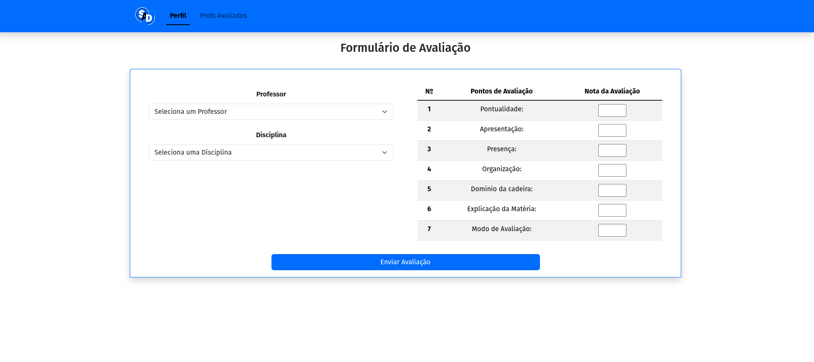
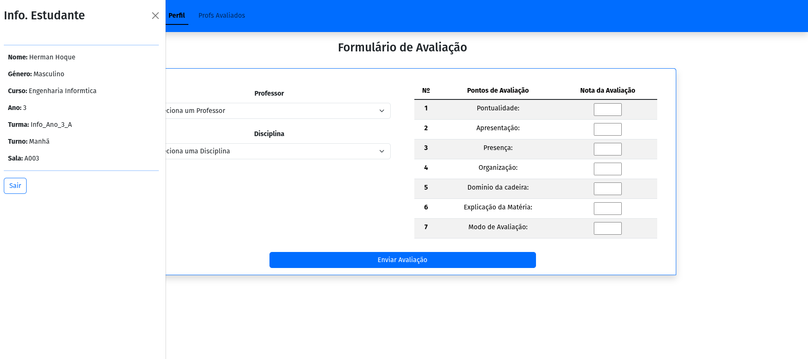
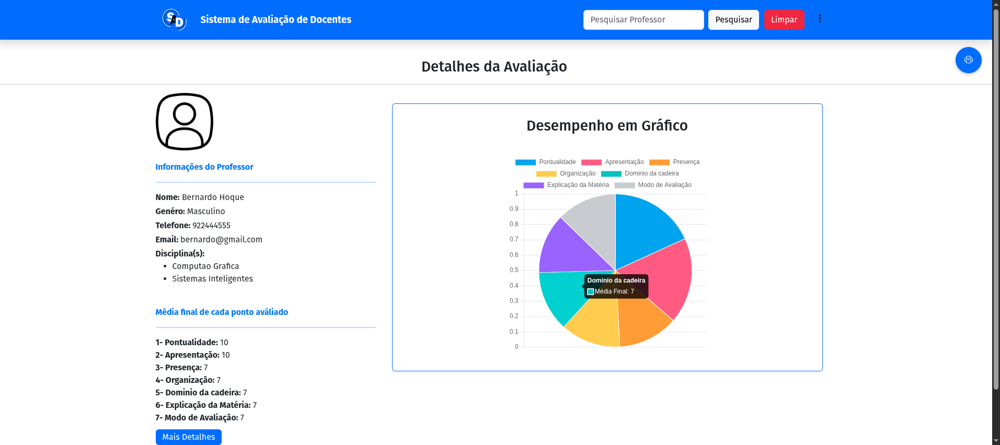

# 🎓 Sistema de Avaliação de Docentes (SAD)

<p align="center">
  <strong>Uma aplicação web para avaliação de docentes e consulta de resultados académicos.</strong>
</p>

<p align="center">
  
  
  
  
</p>

---

## 📌 Sobre o projeto

O **Sistema de Avaliação de Docentes (SAD)** é uma aplicação web desenvolvida em PHP puro no âmbito de um trabalho académico.

O sistema permite que os alunos avaliem os seus professores e disponibiliza um painel administrativo para consultar os resultados obtidos. O seu propósito é facilitar a recolha e a visualização das avaliações através de uma interface simples e organizada.

Este projeto representa uma oportunidade de aplicar conhecimentos de desenvolvimento web, processamento no servidor e visualização de dados.

## 📑 Índice

- [Funcionalidades](#-funcionalidades)
- [Demonstração visual](#-demonstração-visual)
- [Tecnologias utilizadas](#-tecnologias-utilizadas)
- [Requisitos](#-requisitos)
- [Instalação e execução](#-instalação-e-execução)
- [Acesso administrativo](#-acesso-administrativo)
- [Dados de demonstração](#dados-de-demonstração)
- [Dependências externas](#-dependências-externas)
- [Objetivos de aprendizagem](#-objetivos-de-aprendizagem)
- [Autor](#-autor)

## ✨ Funcionalidades

- 📝 **Avaliação de docentes:** permite aos alunos avaliar os seus professores.
- 📊 **Consulta de resultados:** disponibiliza a visualização dos resultados das avaliações.
- 🔐 **Área administrativa:** disponibiliza um painel para administração e consulta dos resultados.
- 📈 **Visualização gráfica:** utiliza o Chart.js para representar dados através de gráficos.
- 📱 **Interface web:** utiliza Bootstrap para a construção dos componentes visuais.

## 🖥️ Demonstração visual

### Página de avaliação



### Perfil



### Painel administrativo



## 🛠️ Tecnologias utilizadas

| Tecnologia | Aplicação no projeto |
|---|---|
| PHP | Processamento e lógica do lado do servidor |
| Bootstrap | Estilização e componentes da interface |
| JavaScript | Funcionalidades executadas no navegador |
| Chart.js | Representação gráfica dos resultados |
| CDN | Carregamento de bibliotecas externas |

## ⚙️ Requisitos

Para executar o projeto localmente, poderás precisar de:

- PHP instalado.
- Servidor web compatível com PHP, como Apache.
- Base de dados e respetivo servidor, se exigidos pela configuração atual.
- Ligação à Internet para carregar as bibliotecas externas através de CDN.

## 🚀 Instalação e execução

### 1. Clonar o repositório

```bash
git clone https://github.com/HermanHoque/SAD.git
```

### 2. Entrar na pasta do projeto

```bash
cd SAD
```

Se o nome da pasta for diferente, utiliza o nome correto.

### 3. Configurar o ambiente

Coloca o projeto no diretório do servidor web ou utiliza outro método compatível com a sua estrutura.

configura a ligação da DB no arquivo controll/conexao.php e importa o respetivo ficheiro SQL presente no repositório

### 4. Iniciar a aplicação

Se tiveres o PHP instalado, podes testar a aplicação com o servidor de desenvolvimento integrado:

```bash
php -S localhost:8000
```

Executa o comando no diretório apropriado para a estrutura do projeto. Se a aplicação depender de configurações específicas do Apache ou de uma base de dados, configura esses serviços antes de testar.

### 5. Abrir no navegador

```text
http://localhost:8000
```

O endereço e a rota inicial podem variar consoante a organização dos ficheiros.

## 🔑 Acesso administrativo

A área administrativa está indicada na seguinte rota:

```text
/SAD/admin
```

Num ambiente local, o endereço poderá ser:

```text
http://localhost/SAD/admin
```

O endereço exato depende da configuração do servidor web.

**Credenciais:** utiliza as credenciais definidas na base de dados da aplicação.

## Dados de demonstração

Este projeto utiliza dados fictícios para fins de desenvolvimento, testes e demonstração.

Os nomes, contactos e outras informações pessoais presentes na base de dados são exemplos e não se destinam a representar pessoas reais.

A base de dados inclui dados académicos de demonstração, como cursos, disciplinas, turmas, professores e alunos.

## 🌐 Dependências externas

O projeto utiliza bibliotecas carregadas através de CDNs, nomeadamente:

- **Bootstrap:** componentes visuais e estilização.
- **Chart.js:** criação de gráficos.

É necessária uma ligação à Internet para carregar essas dependências, salvo se forem configuradas versões locais.

## 🎯 Objetivos de aprendizagem

O desenvolvimento deste projeto permitiu trabalhar conceitos relacionados com:

- Desenvolvimento de aplicações web com PHP.
- Separação entre lógica de servidor e interface.
- Integração de bibliotecas JavaScript.
- Apresentação gráfica de dados.
- Organização e documentação de um projeto de software.

## 👨‍💻 Autor

**Herman Hoque**

Estudante e programador interessado em desenvolvimento web e cibersegurança.

- GitHub: [Visitar o meu perfil](https://github.com/HermanHoque)

---

<p align="center">
  <sub>Projeto académico desenvolvido para fins de aprendizagem e prática de desenvolvimento web.</sub>
</p>

